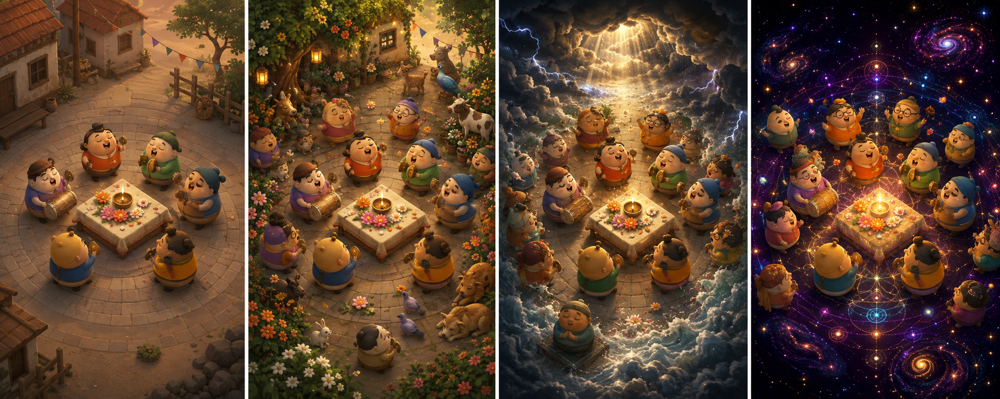

# Kiirtaniyas United

Kiirtaniyas United is an early-stage GPL-3.0 kiirtan rhythm game built on Cytoid's Unity gameplay core. It keeps Cytoid's mobile rhythm interaction and chart format, then adds original kiirtan songs, authored levels, and a single isometric world that evolves with the music.



The image above is the current visual reference: one intimate isometric courtyard that becomes richer and more astonishing as the gathering grows, then moves through heavenly, space-like cosmic, and trippy sacred-geometry stages before the single main character floats alone in cosmic space. It is a mood board, not a final production asset. Its instruments and exact crowd composition are not requirements for the game.

## Current phase

The first vertical slice is implemented. It includes a Blender-authored courtyard and reference-led rounded egg-shaped singer set, a looping Lalita Marmika dance, a real-time Unity stage timeline, an audio-driven MVP scene, and measured easy and medium C2 charts for the 3:00 to 6:30 excerpt of the first song. The charts still need human listening review and device playtesting before release.

## Product direction

- Preserve Cytoid's existing touch rhythm gameplay, scoring, audio synchronization, and C2 chart format.
- Add curated kiirtan recordings and hand-reviewed levels. Level difficulty should come from authored charts and the song, not from spiritual actions hardcoded into the engine.
- Begin with one singer, grow through two, three, and many more singers, and eventually reach a stadium-scale circle. Keep the camera close so larger crowds remain intimate and recede into the background rather than taking over the view. The gathering stays intimate throughout; progression means greater visual richness and scale.
- Keep the visible singers moving clockwise around one central table. This is background choreography, not a note type or player-controlled mechanic.
- Favor raised hands. The alternative pose is joined palms. Production singers should not hold instruments unless this direction is explicitly revisited.
- Let one courtyard become gradually richer with plants, light, weather, and atmosphere. After the heavenly stage, move through a space-like cosmic stage and then a trippy cosmic stage built from sacred geometry and fractals over black. At the very ending, all other characters disappear and the single main character floats alone in cosmic space.
- Build production 3D assets in Blender through Blender MCP and run them as a real-time Unity environment. Generated video is not part of the runtime presentation plan.

## AI-assisted level authoring

Level creation is a first-class part of the project. The intended workflow is audio analysis for BPM, beats, onsets, phrase boundaries, and melody cues, followed by an LLM proposal for a C2 chart, deterministic validation, and human playtesting. The LLM should work from measured audio data and existing chart tools rather than inventing timing values by guesswork. Easy, normal, and harder charts can be derived from one reviewed source chart.

The first song prototype is the 3:00 to 6:30 excerpt of `Hladini shakti kiirtana.mp3`, a 3 minute 30 second section. Because the recording is expressive rather than metronomed, chart authoring should use measured beat timings and a tempo map instead of one fixed BPM.

## Repository layout

- `engines/unity/` - Unity gameplay core, scenes, scripts, storyboard support, and the Flutter bridge.
- `art/blender/` - Editable Blender source and reproducible Blender MCP authoring script.
- `engines/unity/Assets/Kiirtaniyas/` - Runtime models, audio, level metadata, and the visual stage scripts.
- `engines/unity/Assets/Scenes/KiirtanMvp.unity` - The real-time 3D presentation scene for the first vertical slice, also loaded over standalone gameplay.
- `engines/unity/Assets/Scenes/Navigation.unity` - The inherited Cytoid menu flow, decorated with the first Kiirtaniyas song card and difficulty buttons.
- `docs/` - Cytoid host protocol and engine documentation that remains relevant to the fork.
- `reference-images/` - Current visual references and mood boards. These are not production-ready assets.
- `AGENTS.md` - Detailed handoff notes and rules for agents working on Kiirtaniyas United.

## Getting started

The Unity gameplay core lives at `engines/unity/` and targets Unity `6000.0.75f1`.

The Unity CLI is available as `unity` or at `~/.unity/bin/unity`:

```bash
unity status --project-path engines/unity
unity doctor --ci
unity open engines/unity
```

The Cytoid core is embedded through the `cytoid_game_core` Flutter plugin at `engines/unity/flutter_plugin/`. The plugin exposes an engine-agnostic JSON host protocol. See `docs/host-protocol-v2.md` for the current protocol specification.

Licensed Unity packages are optional: install the maintainer `Assets/Vendor/` bundle at `engines/unity/` when required. See [docs/vendor.md](docs/vendor.md). Native Audio is an optional low-latency SFX backend; the project uses Unity audio by default and falls back to it when the licensed package is unavailable.

To inspect the first visual slice, open `engines/unity/Assets/Scenes/KiirtanMvp.unity` with Unity `6000.0.75f1` and enter Play Mode. The scene starts the trimmed excerpt automatically and advances the intimate, heavenly, cosmic-space, cosmic-fractal, and solo-cosmic stages from the AudioSource clock. The Blender singers orbit clockwise and play a 1.2 second looping side-to-side dance. The built-in level package is `engines/unity/Assets/StreamingAssets/Levels/kiirtaniyas.hladini_excerpt.cytoidlevel`.

Useful checks from the repository root:

```bash
python3 tools/audio/validate_c2_level.py \
  --level engines/unity/Assets/Kiirtaniyas/Levels/hladini_shakti_excerpt/level.json \
  --analysis docs/audio/hladini_shakti_excerpt.analysis.json
python3 tools/audio/validate_c2_level.py \
  --level engines/unity/Assets/Kiirtaniyas/Levels/hladini_shakti_excerpt/level.json \
  --chart-type hard
~/.unity/bin/unity test engines/unity --mode EditMode --output /tmp/kiirtan-editmode.xml
~/.unity/bin/unity build engines/unity --target Android \
  --execute-method Kiirtaniyas.Editor.KiirtanMvpBuild.BuildAndroidMvpBatch \
  --output-path /tmp/KiirtaniyasMvp.apk --allow-dirty-build
~/.unity/bin/unity build engines/unity --target Android \
  --execute-method Kiirtaniyas.Editor.KiirtanMvpBuild.BuildAndroidMenuBatch \
  --output-path /tmp/KiirtaniyasMenu.apk --allow-dirty-build
```

The menu APK uses the inherited Bootstrapper, Navigation, and Game scenes plus
the KiirtanMvp scene. The easy and medium buttons load the built-in song
package; the engine's inherited `hard` chart id is displayed as Medium for this
prototype. During play, the 3D world is loaded additively behind the note
playfield and follows the same scheduled music source. The standalone build
also strips the Flutter-host define while compiling, so a previous plugin
export cannot disable the local buttons.

## License

The inherited Cytoid source code is distributed under the [GPL-3.0 License](https://www.gnu.org/licenses/gpl-3.0.en.html). Third-party packages, audio, artwork, and future generated assets may have separate license requirements and must be checked before distribution.
